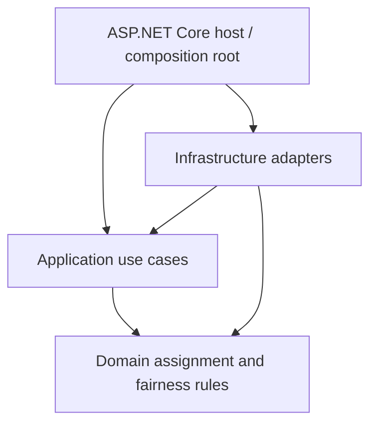

# Festival Assignment — Technical Proposal Appendix

Companion to the [public technical proposal](technical-proposal.md). This appendix
provides traceability for technical readers; it is not an implementation contract
or a new evaluation. All measurements and decisions belong to the linked sources.

## Implemented core and planned interface

The .NET MVP implements request validation, eligibility, contiguous complete-group
placement, historical experience, persistence and conflict handling. The
[Stage 4 completion record](../stage-4/completion.md) describes the integrated
assignment/fairness baseline. The
[simulation architecture](../stage-5/simulation-architecture.md) describes how
the real Application use case is exercised with PostgreSQL and retained evidence.

The public backend dependency structure is:

Arrows show project dependencies, not network topology or a deployment plan.
Domain has no project dependencies. This separation keeps assignment rules
independent of storage and web concerns; it does not establish production readiness.

The validated simulation path invokes Application directly using PostgreSQL.
The existing ASP.NET Core host is minimal and is not a complete attendee-facing
assignment API. Angular is a planned interface direction; the interface,
authentication, operational administration and deployment hardening are outside
the validated core. See the [operating-model scope](../project-operating-model.md#hipótesis-actual-del-mvp-técnico).
The presence of these technologies does not select a cloud provider or final architecture.

## Assignment and fairness boundaries

The [glossary](../glossary.md) and [critical invariants](../critical-invariants.md)
define the model: at most one assignment for each Spot and each Attendee per FestivalDay,
complete groups in consecutive Spots in one row/Zone, valid request identity,
consistent stored outcomes and finality of completed assignments.

Fairness uses prior experience to inform the quality sought for a later group
assignment, subject to eligibility and feasible available inventory. It is a
deterministic online policy: each request uses the information available when it
is evaluated. It is not an entitlement, global optimum or organization-approved
social fairness standard. Groups can change between days; prior histories remain
individual context. The [policy](../stage-4/fairness-definition-v1.md) and
[assignment strategy](../stage-4/assignment-strategy-v1.md) retain the detailed rules.

The evaluation rubric classifies sufficiently observed multi-day paths as
Balanced, Acceptable or NotBalanced. NoPersistedPath and one-assignment
InsufficientEvidence populations remain separately visible; rejection/failure
does not invent an experience or recovery opportunity. Rates use the
[existing populations and denominators](../stage-5/metrics-and-evaluation-criteria.md#32-reporting-populations).

## Evidence supporting the internal Gate

The [Gate result](../stage-5/mvp-technical-feasibility-gate-result.md) is
**Technically Feasible for Proposal**. It evaluates exactly Fairness, Reliability,
Performance and Capacity Utilization, without creating a production acceptance decision.

| Dimension | Existing evidence and decision boundary |
| --- | --- |
| Fairness | Every reviewed S1/S2/S6 run meets the strict internal **BalancedPathRate + AcceptablePathRate > 85%** criterion over ClassifiablePaths. The criterion and rubric remain provisional for organizational acceptance. S5 recipient-level sensitivity and S7/S8 access-selection effects prevent aggregate-only fairness claims. |
| Reliability | Valid completed S1/S2/S5/S6/S7/S8 evaluations and the four valid high-rate stress runs record zero final persisted invariant findings. Losing concurrent transactions leave no partial assignment graph in audited cases. These final-state checks do not prove every temporal behavior or interleaving, nor acceptable operational service. |
| Performance | C1 per-run p95 values are **46.382 / 51.821 / 48.683 ms**. Published unweighted means are **48.962 ms** for per-run p95, **29.593 successful requests/s** and **88.940 persisted Assignments/s**. Each C1 run meets the internal **p95 < 1 second** hypothesis; this local reference is not a production SLA or capacity forecast. |
| Capacity Utilization | S2/S6 fully place **4,400 daily requesting Attendees** in the modeled **4,998-Spot** topology. S6 increases large-group prevalence without observed rejection loss, with modest fairness worsening. S7 demonstrates material fragmentation loss despite eligible free capacity. Final allocation after reconfiguration is untested. |

The performance figures come from the
[C1/C4/C16 analysis](../stage-5/s8-concurrency-analysis.md#performance-and-useful-throughput-c1-vs-c4-vs-c16-per-seed).
The mean of per-run p95 values is not a pooled percentile. Latency measures the
Application/Domain/persistence use case, excluding scope preparation and later
observation, not the full HTTP/browser journey. Useful throughput counts successful
requests or independently reconciled durable Assignments over the same monotonic
workload interval. It is distinct from the rate of terminal attempts, which can
include failures. Local Debug execution, no warm-up, host activity, fixed ordering
and limited repetitions restrict performance generalization.

## Scenario families and authoritative reports

These are provisional simulation inputs, not measured traffic or confirmed venue data.
The table is an evidence index rather than a replacement for the reports.

| Family | Question and retained finding | Source |
| --- | --- | --- |
| S1/S2 representative | Favorable and expected workload hypotheses; complete placement and representative fairness, with S2 unfavorable exposure/recovery limits retained. | [S1/S2 results](../stage-5/s1-s2-representative-results.md), [input contracts](../stage-5/representative-scenarios.md) |
| S5 order | Exact S2 reversal retains relatively stable aggregates but materially changes recipients: only 40.52–41.26% of paired attendee/day qualities remain unchanged. | [Order sensitivity](../stage-5/s2-s5-order-sensitivity-results.md) |
| S6 large groups | Increased prevalence modestly worsens fairness without observed placement/rejection loss under tested topology. Same-Seed cohorts are not exact S2 attendee pairs. | [Large-group sensitivity](../stage-5/s2-s6-large-group-sensitivity-results.md) |
| S7 fragmentation | Capacity-matched spatial pairs show extra rejection; Fragmented rejects 14.959% and leaves 922 Spots unused daily under synthetic approximately 20% preoccupation. Remaining eligible capacity need not form a contiguous block. | [Fragmentation analysis](../stage-5/s7-fragmentation-impact-results.md) |
| S8 / C1 | C1 provides full delivery and low latency. Synchronized C4/C16 stress shows 75% / 93.702–93.716% conflicts and multi-second p95, with persisted integrity protected. | [Concurrency/reference analysis](../stage-5/s8-concurrency-analysis.md) |
| Open-loop High-rate Arrival Stress | Aggressive unsynchronized arrivals produce severe degradation, unexpected failures and hundreds/thousands of active requests. These rates and outcomes do not establish plausible festival traffic behavior. | [High-rate analysis](../stage-5/production-like-arrival-concurrency-analysis.md) |

## Failure interpretation and evidence limits

DomainRejected is a business outcome, such as no complete feasible block for the
current group. KnownConcurrencyConflict is technical contention with rollback;
UnexpectedTechnicalFailure is a separate technical failure category. A high
success rate among normally processed requests must not hide the requests lost
to conflicts/failures. Requesting and participating populations must accompany
survivor-only quality/path rates.

High-rate stress has **four valid runs and five actual official executions**.
The stopped/excluded original collection retains **three audit findings** and
cannot be independently certified clean retrospectively. The
[observer-audit remediation](../stage-5/arrival-observer-audit-remediation.md)
preserves that limitation. Later correlation of independently verified complete
committed graphs does not erase the associated observation failures or reclassify
them as successful requests. Generic technical failures lack exported inner
causes; the reports do not establish a specific root cause for all failures.

Severe concurrency and fragmentation findings remain material. Neither their
production frequency nor avoidance under an actual operating model has been
validated. Plausible coordination, database coordination, controlled retry,
queueing, reconfiguration and selection changes are categories for later
evaluation, not proven solutions or selected architecture.

## Conditional validation and formal review

The [pre-proposal scope decision](../stage-5/pre-proposal-validation-scope.md)
preserves two useful but unexecuted validations:

- **Plausible Festival Arrival Concurrency — Defined / Pending Execution**:
  conditional post-proposal validation if actual arrival behavior indicates
  meaningful concurrency risk. Its [existing contract](../stage-5/plausible-festival-arrival-concurrency.md)
  is an exploratory timing hypothesis, not validated festival traffic.
- **Late Large Groups with Reconfiguration — Pending Definition / Execution**:
  conditional post-proposal validation if actual groups and split/resubmission
  rules make fragmentation/final allocation material. Reconfiguration cannot be
  assumed or used to alter existing completed assignments.

S3/S4 remain **Deferred** until real organization data supports credible stress
and worst-plausible contracts. The
[formal stakeholder/production criteria](../stage-5/decision-gate-criteria.md)
retain organizational acceptance, zero confirmed integrity violations, failure
characterization and applicable mitigation/envelope validation requirements.
The internal Gate waives none of these before the later review. A pilot requires
separate authorization after formal review; neither pilot nor production is
authorized by the public proposal.

## Engineering progression and document authority

The repository preserves domain modeling and invariants → Application implementation
→ PostgreSQL persistence/concurrency protection → assignment/fairness integration
→ simulations and risk discovery → the evidence-based internal Gate → this public
proposal. The [operating model](../project-operating-model.md) and
[Stage 4 completion](../stage-4/completion.md) trace that progression; the
[evidence consolidation](../stage-5/decision-gate-evidence.md) links the evaluated
families. Historical reports retain their original findings and chronology.

The public proposal is **Drafted**, organization review is **Pending**, the MVP
Gate is **Completed**, and Stage 5 remains **In Progress**. This appendix changes
no implementation, scenario evidence, Gate outcome, threshold or business rule.
Organization-specific data, operating commitments, architecture choices, costs
and commercial terms belong in a later private document. The next preparation
task is **Prepare Organization-Facing Proposal Package**.
